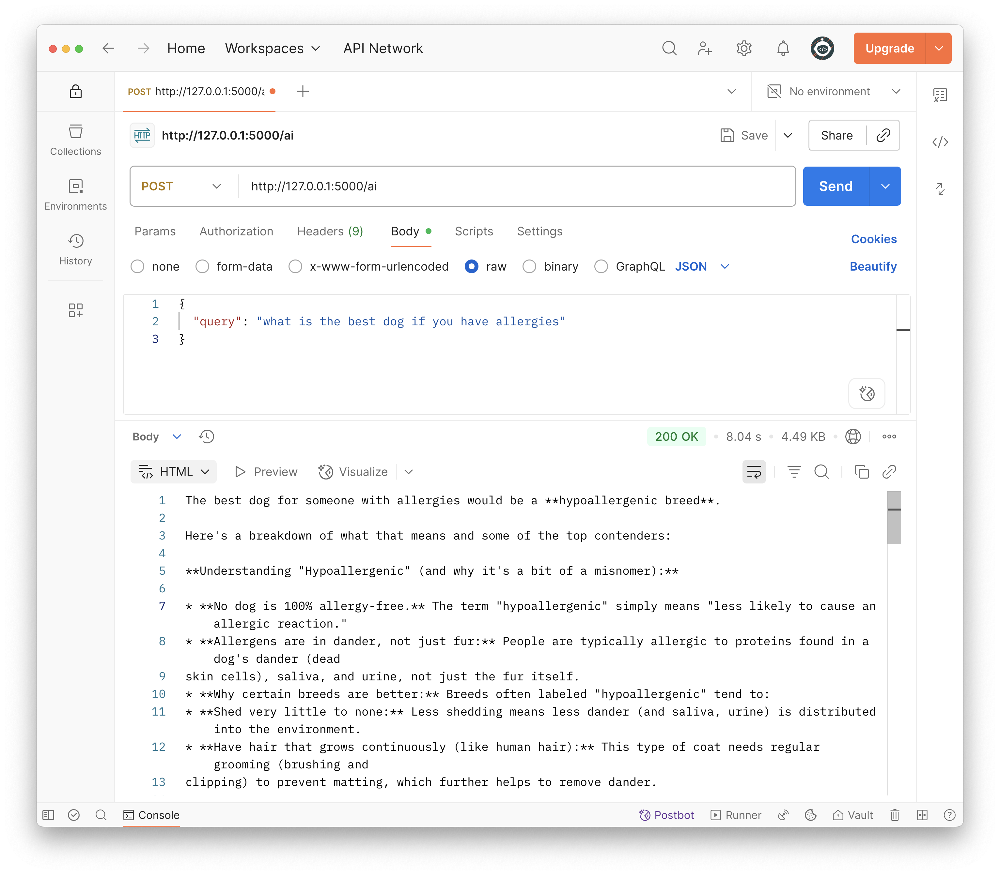

<h1>
  <span class="headline">Post Route</span>
  <span class="subhead">Lesson</span>
</h1>

## Setup


- [Python Genai Codegen Instructions](https://github.com/googleapis/python-genai/blob/main/codegen_instructions.md)
- [Gemini Developer API](https://ai.google.dev/gemini-api/docs)
- [Gemini API quickstart](https://ai.google.dev/gemini-api/docs/quickstart)
- [Test](https://aistudio.google.com/app/apikey?_gl=1*yfj1cc*_ga*NzAyMTQ5NDA3LjE3NTc5NjkzODQ.*_ga_P1DBVKWT6V*czE3NTc5NjkzODMkbzEkZzEkdDE3NTc5Njk5MTMkajYwJGwwJGgxOTQ5MDI4OTI0)


1. Create a POST route for `/ai`
2. What's the request object for Flask?
3. import `from flask import Flask, request`
4. What do we need to replace for the ai query?
1. How to access `query` property: `contents=request.json['query'],`

```py
# # app.py
@app.route('/ai', methods=['POST'])
def create_ai():
    print(request.json)
    response = client.models.generate_content(
        model="gemini-2.5-flash",
        contents=request.json['query'],
        config=types.GenerateContentConfig(
            thinking_config=types.ThinkingConfig(thinking_budget=0) # Disables thinking
        ),
)
    print(response.text)
    return response.text
```

