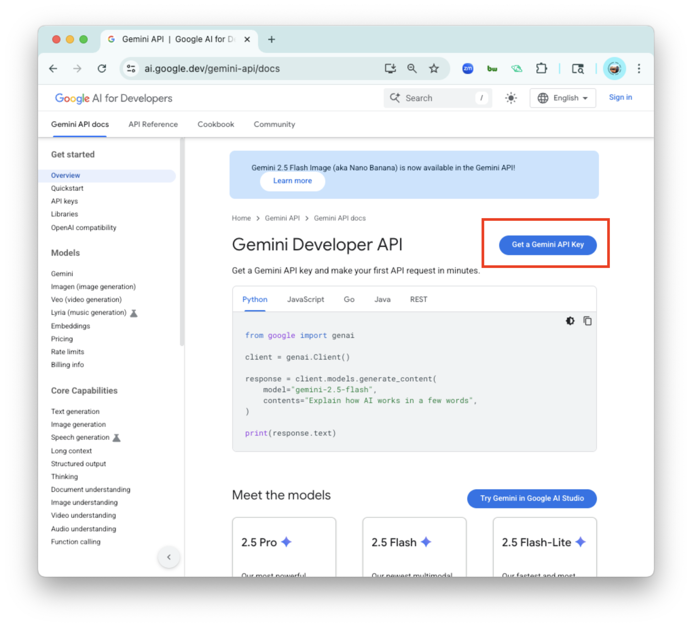
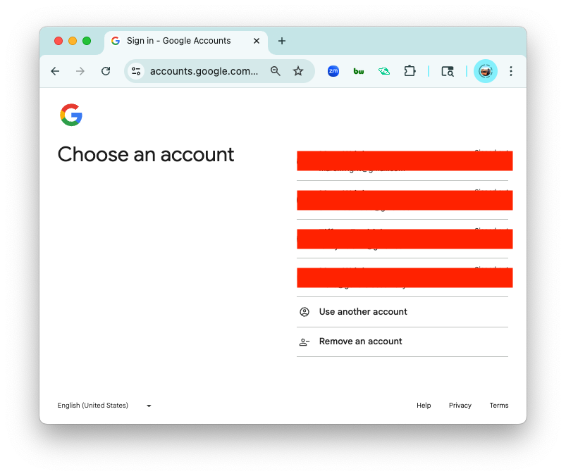
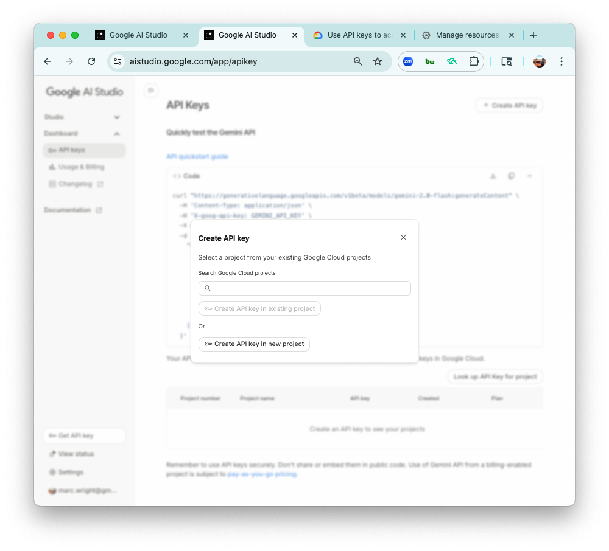
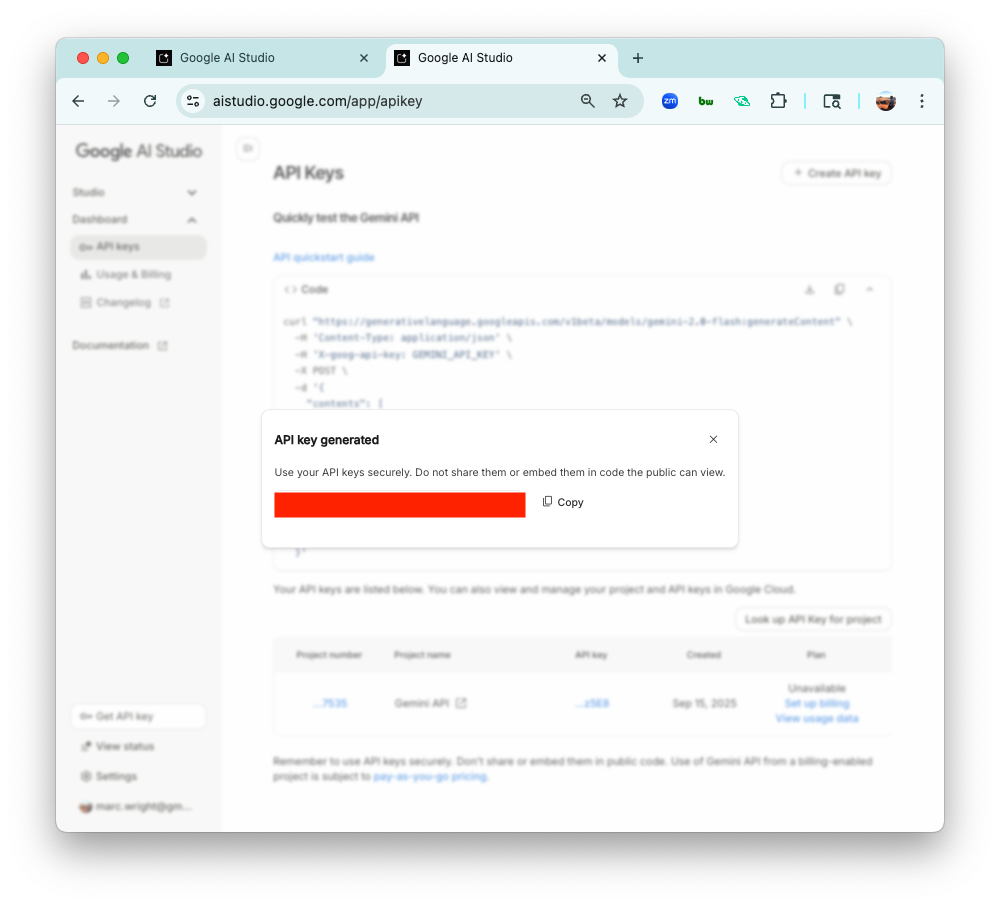
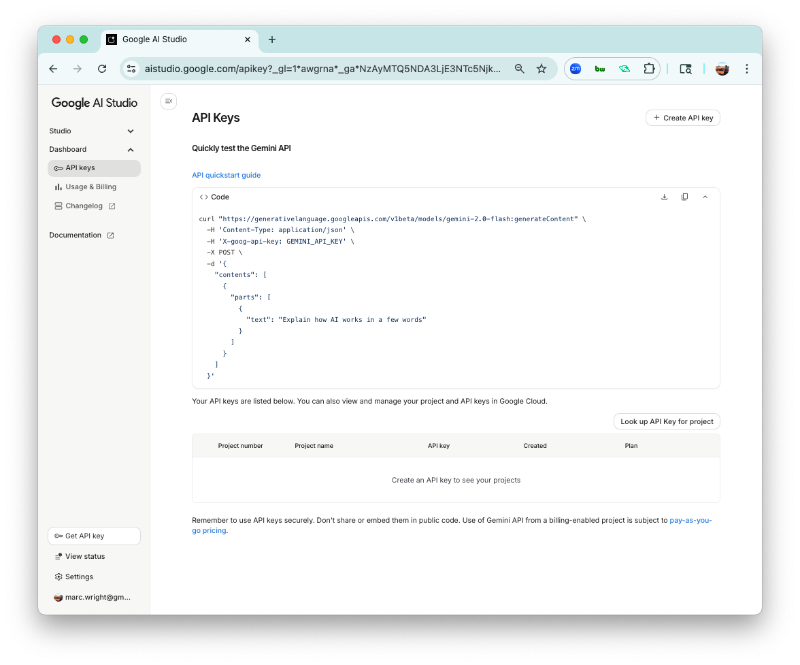
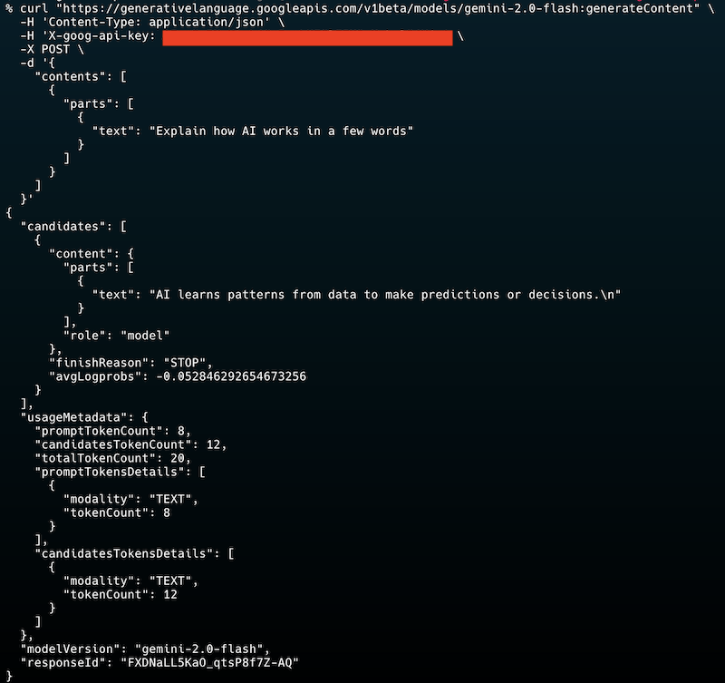

<h1>
  Gemini Intro and Api Key
  Lesson
</h1>

## Helpful Gemini Links

- [Python Genai Codegen Instructions](https://github.com/googleapis/python-genai/blob/main/codegen_instructions.md)
- [Gemini Developer API](https://ai.google.dev/gemini-api/docs)
- [Gemini API quickstart](https://ai.google.dev/gemini-api/docs/quickstart)

 

## What is Gemini?

Gemini is Google/DeepMind’s multimodal AI: it can understand and generate across text, images, audio, video, and code, not just plain language.   It integrates deeply with Google’s ecosystem (Gmail, Calendar, Maps, Drive, etc.) to help with productivity tasks like summarization, brainstorming, planning, and image generation.  

Use cases include writing help, learning and studying (summaries, quizzes), creative work (images, ideas), task automation, and assistance during browsing (summarizing pages, extracting info from open tabs).  

 

## Generate a Gemini API Key

1. To get started with Gemini we need an api key. Navigate to the [Gemini Developer API Docs](https://ai.google.dev/gemini-api/docs) and click "Get a Gemini API Key".

  

2. We're going to use a free version of the API. Since Gemini is a Google product you'll be asked to login with a Gmail account.

  

3. You'll redirect to a Google AI Studio screen. It'll have a sandbox for you to test your API key once it's generated. Click on "+ Create API Key" then "Create API key in new project".

  

4. You should see an API key. You can keep this window open or go ahead and copy the API key. We'll need it in a few more steps.

  

5. To quickly test that your key is valid, you can copy and paste the `curl` request to your Terminal. Replace `GEMINI_API_KEY` with your key.

  

6. Checkout the screenshot below. You'll see a similar response in your Terminal if copied correctly. Feel free to change the `"text"` to request a different query.

  
