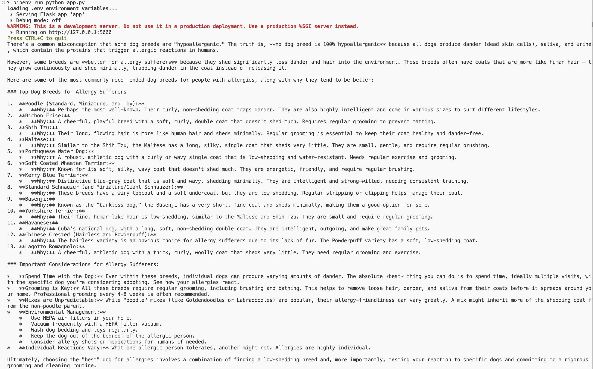

<h1>
  <span class="headline">Turn Off Thinking Mode</span>
  <span class="subhead">Lesson</span>
</h1>

## Setup

- [Python Genai Codegen Instructions](https://github.com/googleapis/python-genai/blob/main/codegen_instructions.md)
- [Gemini Developer API](https://ai.google.dev/gemini-api/docs)
- [Gemini API quickstart](https://ai.google.dev/gemini-api/docs/quickstart)
- [Test](https://aistudio.google.com/app/apikey?_gl=1*yfj1cc*_ga*NzAyMTQ5NDA3LjE3NTc5NjkzODQ.*_ga_P1DBVKWT6V*czE3NTc5NjkzODMkbzEkZzEkdDE3NTc5Njk5MTMkajYwJGwwJGgxOTQ5MDI4OTI0)
- [Thinking Docs](https://ai.google.dev/gemini-api/docs/thinking)

## What are tokens?

In the context of Gemini AI, tokens are the basic building blocks of input and output that the model processes. A token can be as short as a single character (like “a”) or as long as a common word (like “house”), and the model doesn’t see raw sentences but rather sequences of these tokens.

When you type something into Gemini, your text is broken down into tokens, which the model uses to understand context and generate a response. The same applies when Gemini outputs text—it generates tokens one by one until it forms complete sentences.

In practical terms:
	
• Token limits define how much context Gemini can handle at once (e.g., how long your input plus its response can be).
• Token usage affects efficiency and cost when using Gemini via APIs.
• Multimodal tokens extend this concept to non-text inputs (like images or code), letting Gemini interpret and reason about different data types in the same way it does with words.

#### In summary, Gemini charges on a per token basis so we want to optimize and preserve their usage. This is especially true since we're on a free tier and have likm ited free tokens available.

## How Tokens Work

Let’s take a simple example sentence:

Sentence: _Gemini is powerful._

Here’s how it would typically be split into tokens (the exact split depends on the tokenizer Gemini uses, but this illustrates the idea):

    1.	"Gemini" → 1 token
    2.	" is" → 1 token (note the space is included)
    3.	" powerful" → 1 token
    4.	"." → 1 token

So, Gemini is powerful. __= 4 tokens.__

If we expand it:

Sentence: _Gemini is a multimodal AI that understands text and images._

Possible tokenization:

	1.	"Gemini"
	2.	" is"
	3.	" a"
	4.	" multi"
	5.	"modal"
	6.	" AI"
	7.	" that"
	8.	" understands"
	9.	" text"
	10.	" and"
	11.	" images"
	12.	"."

__= 12 tokens.__

👉 Each token is like a puzzle piece. Gemini doesn’t think in terms of whole sentences—it predicts the next token in a sequence until it builds a full, coherent answer.


## Gemini "Thinking" Feature

Since tokens cost $$, we're gonna turn off the Gemini "thinking" feature. From the docs...

> Many code samples on this site use the Gemini 2.5 Flash model, which has the "thinking" feature enabled by default to enhance response quality. You should be aware that this may increase response time and token usage. If you prioritize speed or wish to minimize costs, you can disable this feature by setting the thinking budget to zero.


To demo the difference, I'm going to change the "contents" property to "What's the best breed of dog for allergies". Make sure to restart your server and refresh your browser.

```py
response = client.models.generate_content(
    model="gemini-2.5-flash", contents="What's the best breed of dog for allergies"
)
print(response.text)
```

#### Here is the response with the default "thinking" feature enabled. It's a pretty quality response.



## Turn off the Gemini "Thinking" Feature

We do not need the thinking feature for learning purposes so let's disable it.

1. Import types at the top of `app.py`

    ```py
    from google.genai import types
    ```

2. Next, we'll add a `config` property to our `/ai` route request. Here's the updated code.

    ```py
    @app.route('/ai')
    def ai_request():
        response = client.models.generate_content(
            model="gemini-2.5-flash", contents="What's the best breed of dog for allergies",
            config=types.GenerateContentConfig(
            thinking_config=types.ThinkingConfig(thinking_budget=0) # Disables thinking
            ),
        )
        print(response.text)
        return response.text
    ```

3. Restart your server and refresh your browser. See if your response is now more concise (yours may not be identical).

    
