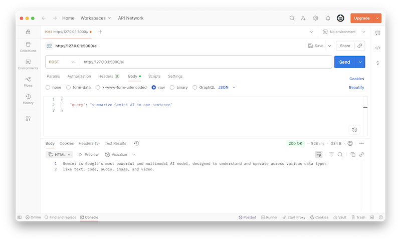

<h1>
  <span class="headline">Use Postman to Send Requests</span>
</h1>

## Links

- [Python Genai Codegen Instructions](https://github.com/googleapis/python-genai/blob/main/codegen_instructions.md)
- [Gemini Developer API](https://ai.google.dev/gemini-api/docs)
- [Gemini API quickstart](https://ai.google.dev/gemini-api/docs/quickstart)
- [Test](https://aistudio.google.com/app/apikey?_gl=1*yfj1cc*_ga*NzAyMTQ5NDA3LjE3NTc5NjkzODQ.*_ga_P1DBVKWT6V*czE3NTc5NjkzODMkbzEkZzEkdDE3NTc5Njk5MTMkajYwJGwwJGgxOTQ5MDI4OTI0)


## Refactor the `/ai` route

Currently, our Gemini request is hardcoded. Let's refactor our route and make it more dynamic so that we can send custom requests from Postman.

1. Our route is a `GET` route currently. We need to re-define it as a `POST` route by adding a `methods` property.

    ```py
    @app.route('/ai', methods=['POST'])
    ```


2. Next, we need to import the Flask `request` module at the top of `app.py`.

    ```py
    from flask import Flask, request
    ```

3. We'll listen for a `query` field in the body of the request. It'll look like this: `request.json['query']`. We'll pass the value of `query` to `contents`. Here's our refactored route:

    ```py
    @app.route('/ai', methods=['POST'])
    def ai_request():
        response = client.models.generate_content(
            model="gemini-2.5-flash", contents=request.json['query'],
            config=types.GenerateContentConfig(
            thinking_config=types.ThinkingConfig(thinking_budget=0) # Disables thinking
            ),
        )
        print(response.text)
        return response.text
    ```

4. Make sure to restart your server.

5. Open Postman to test out our code. Make a `POST` request to `http://127.0.0.1:5000/ai`. The body of the request should be a raw JSON object with a `query` property like so:

    


#### Try sending a few queries of your own!