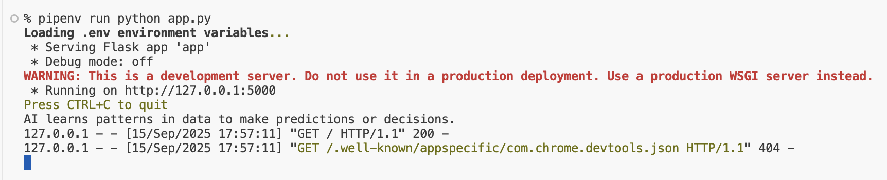

<h1>
  <span class="headline">Flask Gemini API</span>
  <span class="subhead">Lesson</span>
</h1>

## Setup


- [Python Genai Codegen Instructions](https://github.com/googleapis/python-genai/blob/main/codegen_instructions.md)
- [Gemini Developer API](https://ai.google.dev/gemini-api/docs)
- [Gemini API quickstart](https://ai.google.dev/gemini-api/docs/quickstart)
- [Test](https://aistudio.google.com/app/apikey?_gl=1*yfj1cc*_ga*NzAyMTQ5NDA3LjE3NTc5NjkzODQ.*_ga_P1DBVKWT6V*czE3NTc5NjkzODMkbzEkZzEkdDE3NTc5Njk5MTMkajYwJGwwJGgxOTQ5MDI4OTI0)


## Install the Google GenAI SDK

```bash
pipenv install google-genai
```

Add this to your root route:

```py
from google import genai

# The client gets the API key from the environment variable `GEMINI_API_KEY`.
client = genai.Client()

response = client.models.generate_content(
    model="gemini-2.5-flash", contents="Explain how AI works in a few words"
)
print(response.text)
```

Your index route should look like so:

```py
@app.route('/')
def index():
    client = genai.Client()

    response = client.models.generate_content(
        model="gemini-2.5-flash", contents="Explain how AI works in a few words"
    )
    print(response.text)
    return "Hello, world!"
```
