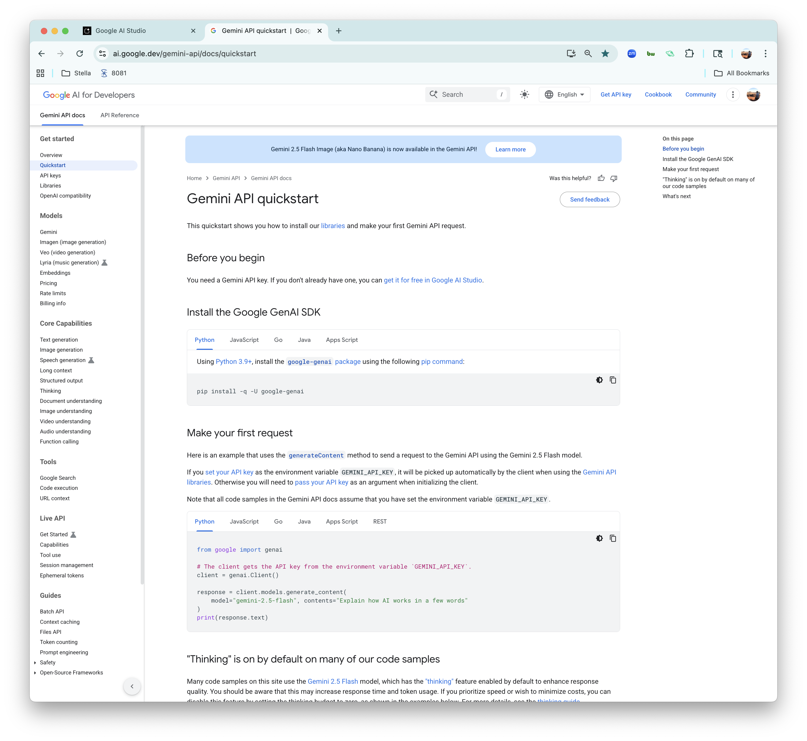
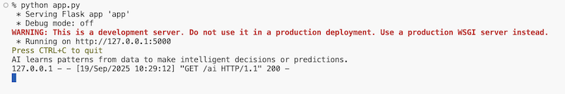
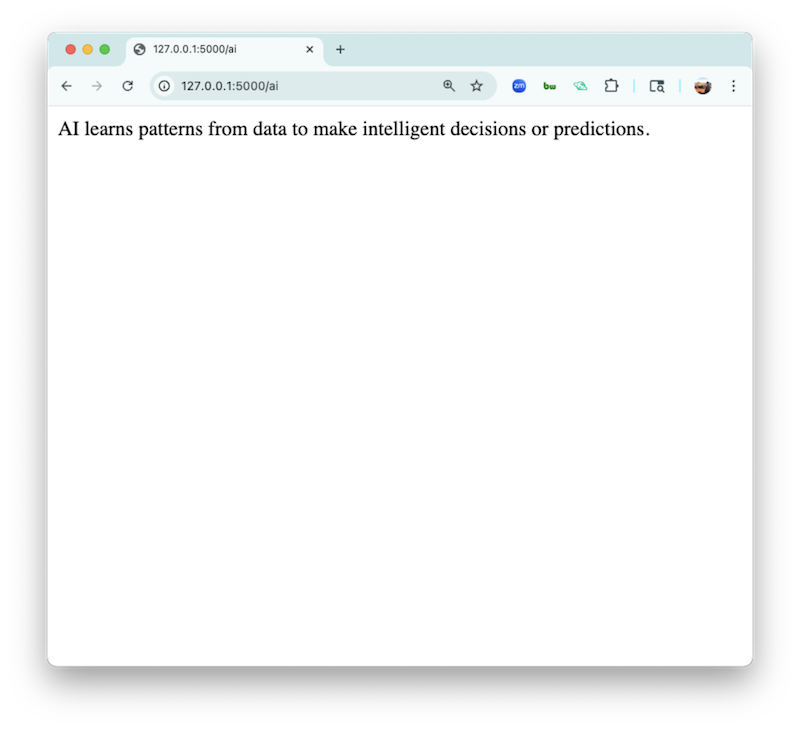

<h1>
  <span class="headline">Flask Gemini API Quickstart</span>
  <span class="subhead">Lesson</span>
</h1>

## Setup

- [Python Genai Codegen Instructions](https://github.com/googleapis/python-genai/blob/main/codegen_instructions.md)
- [Gemini Developer API](https://ai.google.dev/gemini-api/docs)
- [Gemini API quickstart](https://ai.google.dev/gemini-api/docs/quickstart)
- [Test](https://aistudio.google.com/app/apikey?_gl=1*yfj1cc*_ga*NzAyMTQ5NDA3LjE3NTc5NjkzODQ.*_ga_P1DBVKWT6V*czE3NTc5NjkzODMkbzEkZzEkdDE3NTc5Njk5MTMkajYwJGwwJGgxOTQ5MDI4OTI0)

## Connect Flask to Gemini

To connect Flask to Gemini we'll follow the [Gemini quick start instructions](https://ai.google.dev/gemini-api/docs/quickstart).



## Install the Google GenAI SDK

First, we need to install the Google GenAI SDK. Note - your install may be slightly different if you're using `pipenv`.

```bash
pipenv install google-genai
```

## Make your first request

1. Following the documentation, we first need to add this to the top of `app.py` with our other imports.

    ```py
    from google import genai
    ```

2. Next, we need to establish a connection to the Gemini API. Note that the documentation states... 

    > If you set your API key as the environment variable GEMINI_API_KEY, it will be picked up automatically by the client when using the Gemini API libraries.

    I added the following line just below `app = Flask(__name__)`.

    ```py
    # The client gets the API key from the environment variable `GEMINI_API_KEY`.
    client = genai.Client()
    ```

3. Next, let's define a new route named `/ai`. This is where we'll add the additional bit of code from the documentation:

    ```py
    @app.route('/ai')
    def ai_request():
        response = client.models.generate_content(
            model="gemini-2.5-flash", contents="Explain how AI works in a few words"
        )
        print(response.text)
        return response.text # I added this return statement because Flask requires one.
    ```

4. Restart your server and navigate to `http://127.0.0.1:5000/ai` in your browser. If everything works correctly you should see the `response.text` in your server logs.


   

5. The text should also return to the browser.

   

#### Congrats! You've successfully made a request to an AI!