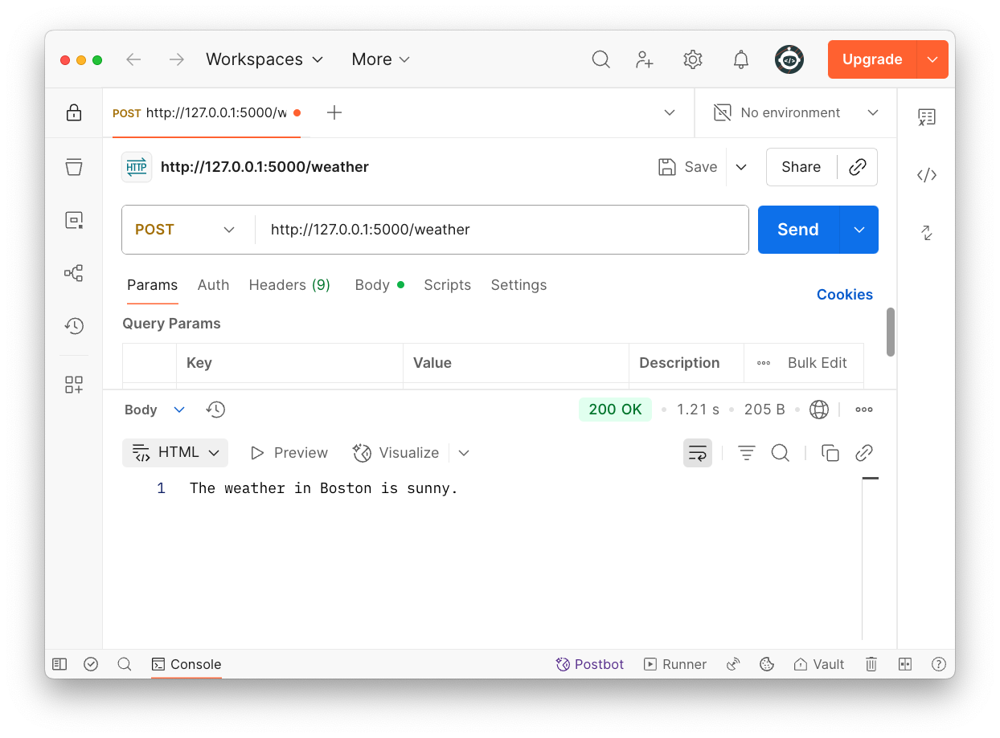

<h1>
  <span class="headline">Weather</span>
  <span class="subhead">Lesson</span>
</h1>

## Setup

- [Python Genai Codegen Instructions](https://github.com/googleapis/python-genai/blob/main/codegen_instructions.md)
- [Gemini Developer API](https://ai.google.dev/gemini-api/docs)
- [Gemini API quickstart](https://ai.google.dev/gemini-api/docs/quickstart)
- [Test](https://aistudio.google.com/app/apikey?_gl=1*yfj1cc*_ga*NzAyMTQ5NDA3LjE3NTc5NjkzODQ.*_ga_P1DBVKWT6V*czE3NTc5NjkzODMkbzEkZzEkdDE3NTc5Njk5MTMkajYwJGwwJGgxOTQ5MDI4OTI0)

- [Thinking Docs](https://ai.google.dev/gemini-api/docs/thinking)

# https://github.com/googleapis/python-genai/tree/main?tab=readme-ov-file#function-calling

## Turn off thinking

refresh browser after adding dog question

```py
@app.route('/weather', methods=['POST'])
def create_weather():
    response = client.models.generate_content(
        model="gemini-2.0-flash-001",
        contents="What is the weather like in Boston?",
        config=types.GenerateContentConfig(
            tools=[get_current_weather],
            thinking_config=types.ThinkingConfig(thinking_budget=0) # Disables thinking
        ),
    )
    print(response.text)
    return response.text
```

